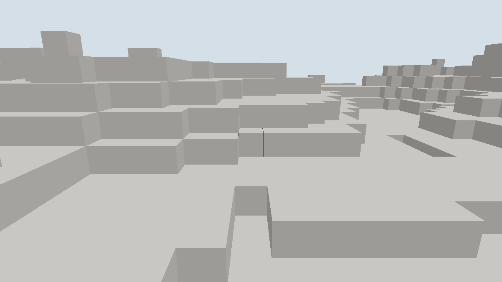

# 窗口动作场景记录

日期：[20261024]
类型：验收
状态：已验收
环境：Windows 11 x86_64，Rust 1.93.1，debug与release profile，Vulkan 后端（Intel RaptorLake 核显）
范围：未记录

## 目标

窗口点击经拾取与A6动作服务提交事务，画面变化为真实管线输出。

## 方法

未记录

## 结果

### 输出

```text
# debug，360帧加截图
frames=361 streams=2 rebuilds=71 uploads=17 screenshots=1 actions_ok=16
actions_rejected=0 sections=49 meshes=49 vertices=145032 faces=36258 elapsed_ms=1863

# release，2400帧
frames=2400 streams=3 rebuilds=198 uploads=102 actions_ok=100 actions_rejected=0
sections=81 meshes=81 vertices=239324 faces=59831 elapsed_ms=3175
```

### 判读

- 动作链完整工作：拾取射线找到目标格与进入面，右键沿面放置、左键破坏所在格；每次编辑经`ActionService::plan`授权校验后由`WorldAuthority::commit`提交，计数`actions_ok`与触发次数一致（360帧每24帧一次共16次，2400帧共100次），无拒绝。
- 编辑即时反映到画面：每次提交改变分区修订戳，下一帧按需重建网格并整体重传顶点，`uploads`比无动作的流式运行多出与动作数一致的次数。
- 选中框复用同一着色器以线框管线绘制，只读深度不写入，视觉检查确认套在准星目标上且不遮挡地形。
- 拾取在首个未装载格终止，未装载区域内不产生放置或破坏；相机起始高度钳制在已装载层内，保证出生即可交互。
- 放置动作直接写地形，不消耗库存；这是A6方块动作的既有语义，库存联动属于后续玩法装配。

## 复现

### 运行命令

```sh
# 交互：右键放置选中材质，左键破坏，数字键1到3切换石头/玻璃半砖/植物
cargo run -p torse-client -- --window --radius 4
# 自动取证：前向飞行并每24帧交替破坏/放置准星目标，呈现指定帧数后退出
cargo run -p torse-client -- --window --autoplay --frames 360 --screenshot figures/M1-actions.png --radius 3
```

## 边界

### 未覆盖

- 放置不扣库存、破坏不产生掉落；命令解析、网络输入与请求去重仍待装配。
- 拾取把非空格按完整立方体处理，半砖与植物的精确形状选中未实现。
- 只装载`y = 0`分区层，编辑与拾取限于此层；多层装载随流式任务扩展。
- CI 不执行窗口运行；结果需本机复跑。

## 画面



相机贴近地表前向飞行，准星套在目标方块上的深色线框为选中框；画面中的凹陷是自动破坏留下的缺口。截取于debug运行最后一帧。
