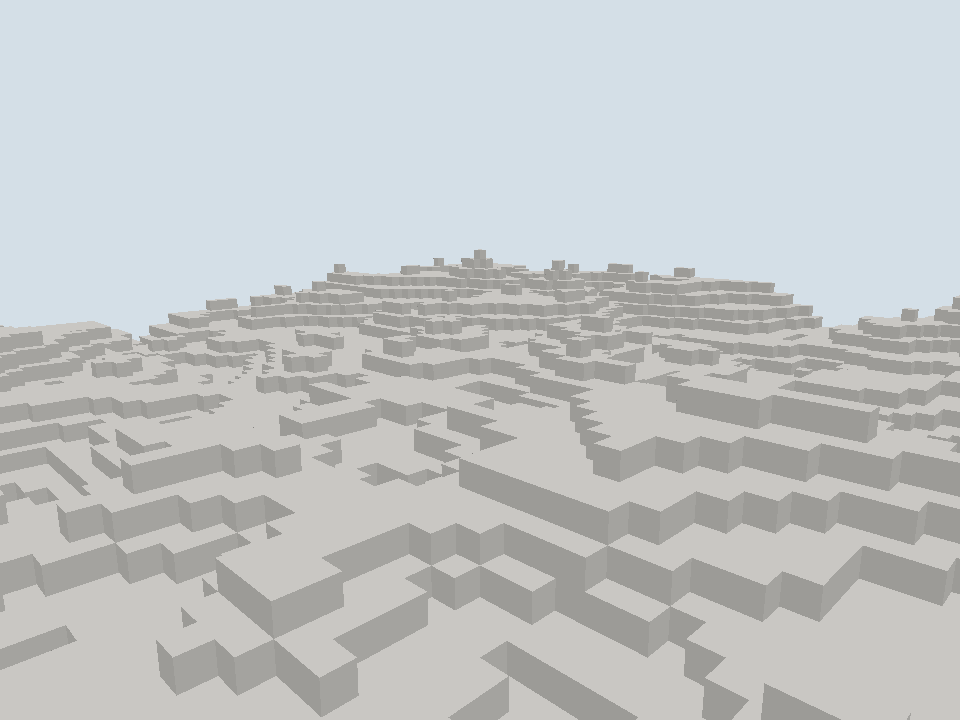

# 离屏渲染场景记录

日期：[20261024]
类型：验收
状态：已验收
环境：Windows 11 x86_64，Rust 1.94.0，debug profile，Vulkan 后端（Intel RaptorLake 核显）
范围：未记录

## 目标

输出为真实显卡绘制的一帧，非示意图。

## 方法

未记录

## 结果

### 输出

```text
sections=25 meshes=25 entities=0 seq=0 vertices=76832 indices=115248 faces=19208 eye=(40.0,18.0,40.0) elapsed_ms=614
```

### 判读

- 画面由真实管线产生：顶点缓冲来自网格任务，深度测试与方向光在着色器里计算，颜色按方块内容映射。
- 分区接缝处没有空洞，说明网格任务的邻区版本校验与边界面保留有效。
- 台阶状起伏来自高度场的逐格量化，符合纯方块地形的预期。
- `faces=19208`与画面面数一致，`elapsed_ms`包含生成、网格与一帧绘制，不作为性能数据。

## 复现

### 运行命令

```sh
cargo run -p torse-client -- --capture out.png --width 960 --height 720 --radius 2
```

## 边界

### 未覆盖

- 窗口、输入与连续循环未接；当前只渲染一帧。
- 无纹理、阴影与透明排序，材质只有单一颜色。
- 场景内没有实体；实体表现随窗口循环补齐。
- CI 不执行渲染，只编译客户端；GPU 结果需本机复跑。

## 画面



俯视全景相机位于`(40, 18, 40)`，看向`(0, 6, 0)`。地形为种子7的丘陵生成器，基准高度7、振幅9，分区边长16，半径2。
