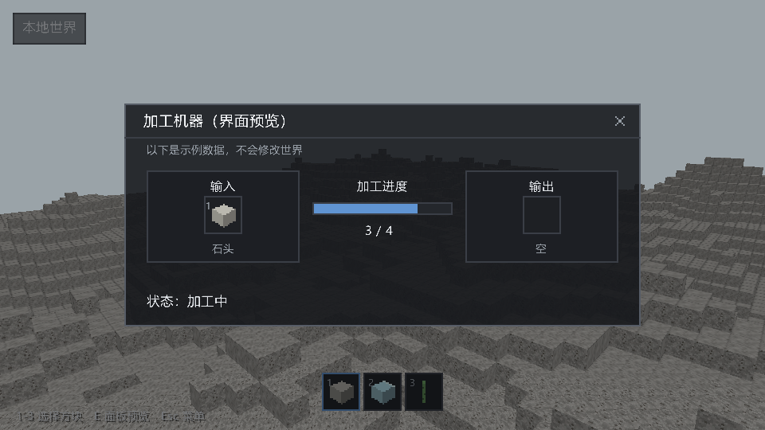
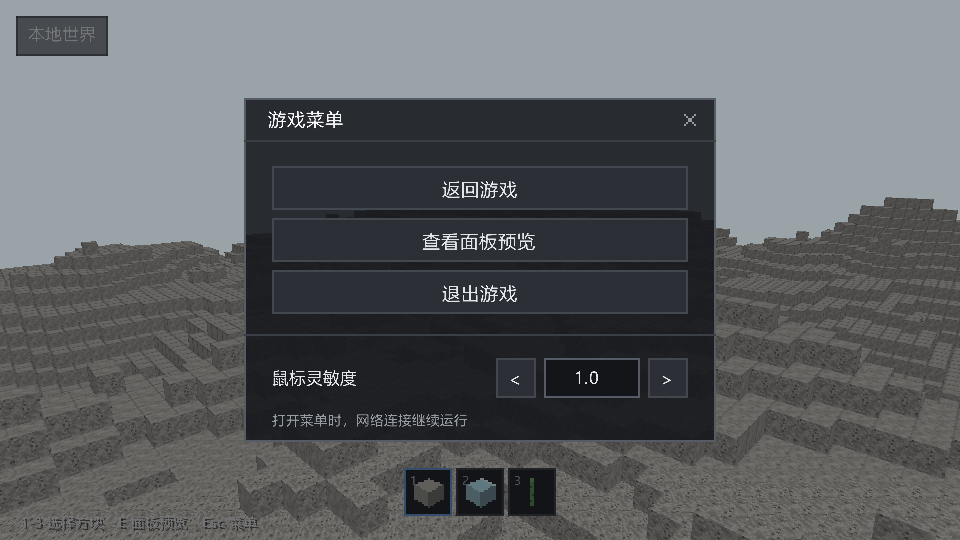
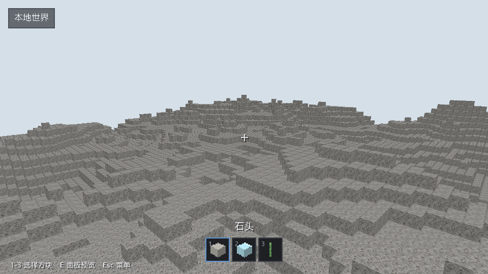

# 界面主题改版

日期：[20261025]
类型：验收
状态：已验收
环境：Windows，Rust 1.93.1，Vulkan，960x540，NVIDIA GeForce RTX 4080 SUPER
范围：未记录

## 目标

本轮把客户端界面从PNG九宫格皮肤改为程序化绘制的深色扁平主题，交互语义与对外接口不变。

## 方法

### 行为

窗体、按钮、槽位、进度条、准星与提示框全部由新增的`ui/style.rs`在画布上绘制：半透明深灰面板配一像素边框，标题栏带分隔线与关闭叉号；按钮分常态、悬停与按下三态，按下与选中槽位共用同一强调色，该色不承担其他语义。HUD改为深色信息条、结果条与带边框槽位，准星改为带阴影的十字。物品图标继续使用`icons/items`的三张16x16 PNG，文案与字体加载不变。

暂停菜单重排为标题栏加三行整宽按钮，灵敏度行改为数值框加左右步进按钮；机器面板改为输入、输出两个分组框加中列进度，进度条与分组框留出间距，比例文字按测量宽度居中。模态打开时隐藏快捷栏上方的当前物品名，避免与面板底边重叠。`close`文案键随机器面板底部按钮一并移除，面板经标题栏叉号或原快捷键关闭。

基础游戏删除11张不再使用的界面皮肤PNG，素材说明同步改为程序化主题；本轮没有新增素材。

## 结果

### 验证

新增3项主题测试覆盖边框底色、进度内缩与准星单次混合；素材测试改为只校验三张物品图标。快捷栏选中边框经像素取色确认落在首格。客户端60项测试通过，全工作区545项通过，格式与全工作区Clippy零告警。

三种界面模式离屏捕获与真实窗口surface读回各目检一轮：比例文字完整（4倍放大复核，两次整图目检把末位误报为缺失）、进度条与分组框有间距、无色彩通道错位。复现命令：

```sh
cargo test -p torse-client --locked
cargo run -p torse-client -- --capture .work/ui.png --width 960 --height 540 --ui-preview pause
cargo run -p torse-client -- --window --ui-preview pause --frames 8 --screenshot .work/menu.png
```

## 复现

未记录

## 边界

未记录

## 画面



机器面板：输入组带示例物品与数量，输出组为空，中列进度与比例，底部状态行。



暂停菜单：标题栏、三个整宽按钮、灵敏度行与说明，快捷栏在遮罩后继续可见。



HUD：选中槽位强调边框、深色状态条、十字准星与帮助行。

## 后续

界面仍是固定逻辑布局，没有锚点、缩放设置与可拖动窗口；机器面板继续使用示例数据，真实机器状态按B10接线接入。文字栅格化的锐化阈值与字体选择沿用既有实现。
