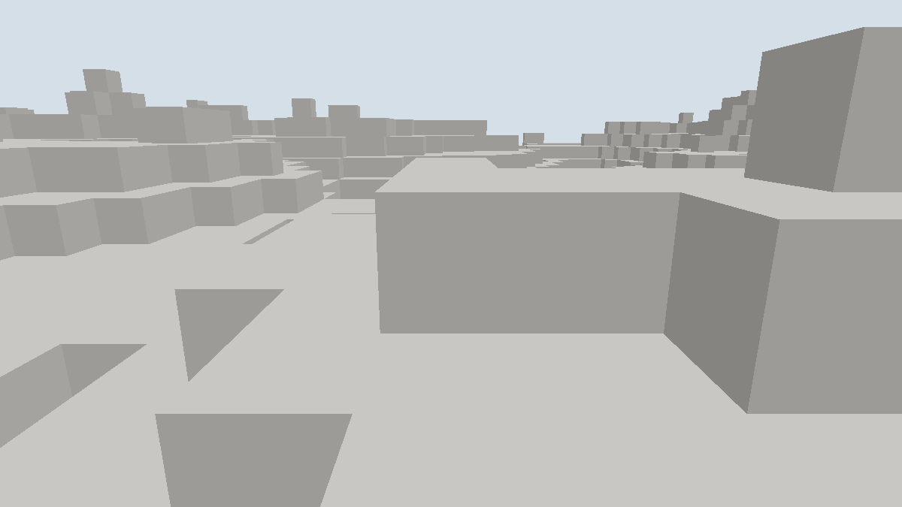

# 窗口交互渲染场景记录

日期：[20261024]
类型：验收
状态：已验收
环境：Windows 11 x86_64，Rust 1.93.1，debug与release profile，Vulkan 后端（Intel RaptorLake 核显）
范围：未记录

## 目标

连续循环、输入与分区流式装载为真实窗口运行，非离屏单帧。

## 方法

未记录

## 结果

### 输出

```text
# debug，120帧加截图
adapter=Intel(R) RaptorLake-S Mobile Graphics Controller backend=Vulkan format=Bgra8UnormSrgb
frames=121 streams=1 rebuilds=49 uploads=1 screenshots=1 sections=49 meshes=49
vertices=145280 faces=36320 elapsed_ms=486

# release，4000帧
frames=4000 streams=3 rebuilds=99 uploads=3 screenshots=0 sections=81 meshes=81
vertices=239292 faces=59823 elapsed_ms=3261
```

### 判读

- 连续循环真实工作：每帧集成输入、按需重建网格并呈现，debug下121帧487ms（约248 fps），release下4000帧3.26s（约1226 fps）。呈现模式取适配器能力表首个，本机未启用垂直同步，帧率不构成性能承诺。
- 分区流式装载有证据：release运行中相机跨越两个分区边界，`streams=3`（初次装载加两次重定心），每次重定心后仅新进入窗口的分区重建（两次各9个，`rebuilds`从81到99），装载区数量恒为81，卸载路径无泄漏。
- 几何按需上传：仅在网格变化时重建顶点缓冲，`uploads`与`streams`一致，静止视野不产生上传。
- 截图通道经过BGRA到RGBA的转换：surface格式为`Bgra8UnormSrgb`，与离屏路径的`Rgba8UnormSrgb`不同；截图在绘制提交之后、呈现之前拷贝，内容与画面一致。
- 窗口标题每0.5秒刷新一次帧率与分区计数，交互模式可直接观察。

## 复现

### 运行命令

```sh
# 交互飞行：WASD移动，空格/Shift升降，按住鼠标拖动转向，滚轮调速，F12截图，Esc退出
cargo run -p torse-client -- --window --radius 4
# 自动取证：前向匀速飞行，呈现指定帧数后退出并存最后一帧
cargo run --release -p torse-client -- --window --autoplay --frames 4000 --radius 4
cargo run -p torse-client -- --window --autoplay --frames 120 --screenshot figures/M1-window.png --radius 3
```

## 边界

### 未覆盖

- 场景内没有实体，`Simulation`未接入；实体渲染与网络联机随客户端后续任务补齐。
- 无纹理、阴影与透明排序；材质仍为单一颜色。
- 窗口尺寸变化后surface重配置与深度重建已接，但未做自动化测试，仅代码路径审查。
- CI 不执行窗口运行，只编译客户端；窗口结果需本机复跑。

## 画面



初始相机站在`scene.eye()`给出的地表位置，默认带轻微俯角，自动飞行方向为负z。半径3共49个分区，画面与离屏路径共用同一网格与管线。
