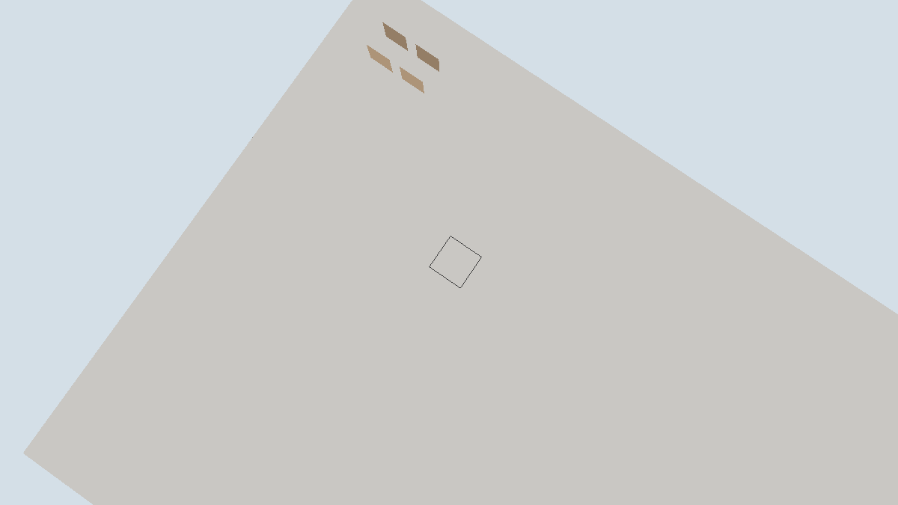

# 联网图形客户端场景记录

日期：[20261024]
类型：验收
状态：已验收
环境：Windows 11 x86_64，Rust 1.93.1，debug profile，Vulkan 后端（Intel RaptorLake 核显），本机TCP回环
范围：未记录

## 目标

客户端经真实TCP连接独立服务端，消费A7授权基线并渲染，编辑请求走完整请求-准入-结果链路。

## 方法

未记录

## 结果

### 输出

```text
# 600帧自动运行
frames=600 session=10 batches=0 requests_sent=25 requests_rejected=22
baseline_sections=2 sections=2 meshes=2 vertices=4528 faces=1144 elapsed_ms=516

# 300帧加截图
frames=301 session=11 batches=0 requests_sent=13 requests_rejected=9
```

### 判读

- 握手与内容摘要匹配：客户端用与服务端相同的装配（m0夹具加方块动作加库存模块注册）计算兼容信息，Welcome与Seed正常到达，重连获得新会话编号（11次运行session从1到11不复用）。
- 镜像到渲染链路完整：基线的2个分区经符号表解析回本地注册表状态并装载，网格与顶点正常生成；实体以持久身份`insert_restored`重建并以色块入画，这是实体首次出现在画面里。
- 请求链路端到端：25个破坏请求经Admission进入执行，22个以拒绝结果返回（访客无编辑授权，PermissionDenied语义），客户端计数并在标题显示最近结果；镜像零污染，`batches=0`、顶点数不变，本地从未提交任何编辑。
- 调试中修掉两个真实缺陷：其一，基线到达前帧循环因场景为空而跳过，网络轮询随之停摆，窗口死在未初始化的白屏，已改为场景未到时持续呈现清除帧；其二，基线相机 overlook 高于已装载层，拾取射线第一步就停在未装载格，请求从未发出，已把观察点压进装载层内并近乎垂直俯视。

## 复现

### 运行命令

```sh
# 服务端：新世界铺一层石头地面，持续Tick
torse-server <world-dir> --listen 127.0.0.1:7799 --fill
# 客户端：连接、镜像、渲染；autoplay每24帧对准星目标发一次破坏请求
torse-client --window --connect 127.0.0.1:7799 --autoplay --frames 300 --screenshot figures/M5-net-client.png
```

## 边界

### 未覆盖

- 访客策略只读：授权编辑需要A侧的范围授权扩展（ActorContext目前逐格授权），联网放置破坏待该领域扩展后接线。
- 订阅范围固定为演示scope（2个分区），无随玩家移动的订阅变更；增量批次路径已有服务端测试覆盖，本场景世界静态故batches为0。
- 客户端行走可在镜像地形上本地预测，但未经服务端校正；移动走请求路径待后续。
- CI 不执行窗口与网络运行；结果需本机复跑。

## 画面



画面为服务端演示世界的授权投影：灰色石板地面（服务端`--fill`初始世界内容）与两个橙棕色实体盒（服务端装配的两个库存实体）。基线相机近乎垂直俯视，避免视线漂出32x16格的订阅范围。
