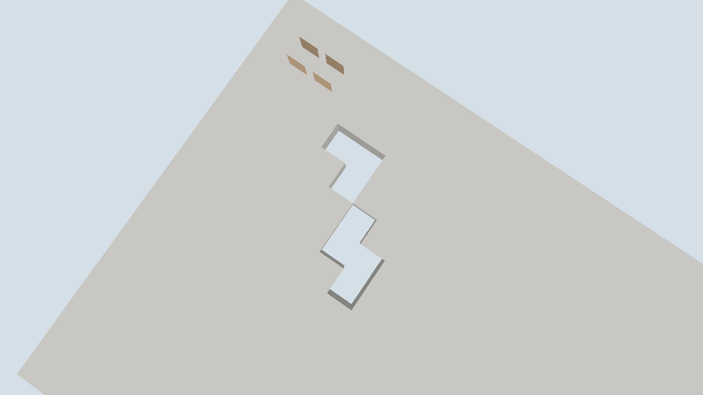

# 联机编辑场景记录

日期：[20261024]
类型：验收
状态：已验收
环境：Windows 11 x86_64，Rust 1.93.1，debug profile，Vulkan 后端（Intel RaptorLake 核显），本机TCP回环
范围：未记录

## 目标

客户端编辑经服务端授权提交，A7批次回投镜像并反映到画面，完整M5编辑闭环。

## 方法

未记录

## 结果

### 输出

```text
# 600帧自动运行
frames=600 session=1 batches=6 requests_sent=12 requests_rejected=4
rebuilds=7 uploads=6 vertices=4544 faces=1148 elapsed_ms=435

# 联网客户端只读对照（无--editors）
requests_sent=25 requests_rejected=22 batches=0
```

### 判读

- 范围授权生效：ActorContext新增分区授权，宿主把订阅scope逐分区授予编辑者；放置与破坏请求在服务端经`ActionView::terrain`与事务块检查按分区放行，scope外与无权限仍拒绝。访客对照运行25个请求22个拒绝，编辑者运行12个请求8个提交、4个因重复破坏或占位冲突被拒（业务冲突，非权限）。
- 编辑闭环完整：每次服务端提交产生一个可见事务，A7投影为批次回投；客户端镜像重装受影响分区、重建网格并重传顶点，`batches=6`与`rebuilds=7`对应（一次同帧合并），画面顶点数从基线4528变为4544。截图经检查凸起与缺口并存。
- 会话复用与去重路径未变：重连获得新会话编号，请求序号从1单调递增。

## 复现

### 运行命令

```sh
# 服务端：新世界铺地面，连接者获得订阅范围内的编辑授权
torse-server <world-dir> --listen 127.0.0.1:7801 --fill --editors
# 客户端：连接并自动对准星目标交替放置/破坏
torse-client --window --connect 127.0.0.1:7801 --autoplay --frames 600
```

## 边界

### 未覆盖

- 授权策略为演示级：`--editors`对所有连接授同一编辑者身份，真实认证与按玩家授权待应用层。
- 客户端无本地预测回滚：提交结果以服务端批次为准，点击到回投之间有一到两个Tick延迟。
- 订阅仍固定演示scope；行走移动不走请求路径。CI不执行窗口与网络运行，结果需本机复跑。

## 画面



俯视石板地面：凸起的方块为服务端接受的放置，凹陷缺口为服务端接受的破坏，两个橙棕色实体盒保持可见；所有变化经授权批次回投镜像，客户端本地零提交。
