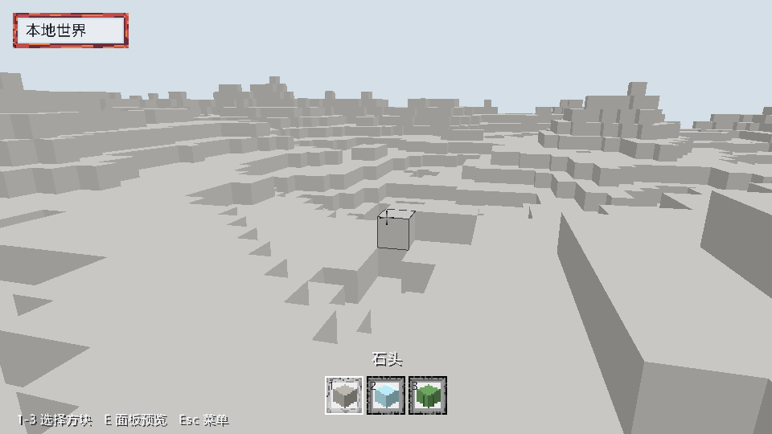
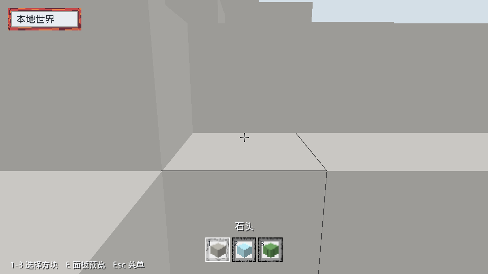

# 有界生成与网格执行

日期：[20261025]
类型：测量
状态：已验收
环境：Windows 11 Pro 10.0.26300、Intel Core i7-14700KF、NVIDIA GeForce RTX 4080 SUPER、Vulkan、Rust 1.93.1、Release、默认960x540窗口
范围：C00第二阶段

## 目标

代码基线54c0ef8及串行基线、有界执行器两阶段工作区改动。已接入窗口客户端的生成与网格，服务端权威规划、提交和持久确认继续使用原有串行路径。

## 方法

### 二、场景接入与结果校验

窗口启动同步装载脚下一个Section，其余本地分区按距离请求后台生成。生成只返回Section，场景线程重新检查世界代数、生成版本、请求装载代数、目标仍未装载以及当前需求，然后安装。任务未完成时查询仍为NotLoaded。

网格任务只取得目标分区及一格邻域的拥有所有权的输入。预留成功后才复制输入，工作线程不借用世界或注册表。结果依赖如下：

| 依赖 | 检查目的 |
|---|---|
| 场景WorldEpoch | 旧世界结果不能进入新世界 |
| 资源代数 | 资源变化后的旧几何失效；当前资源固定，代数变更由测试注入 |
| 目标及六邻区地形修订 | 编辑和边界变化使旧网格失效 |
| 目标及六邻区装载代数 | 卸载重载即使复用相同修订，也拒绝旧结果 |
| 当前需求与可读状态 | 离开窗口取消任务，未装载数据不成为有效输入 |

每个目标最多保留一个当前任务。持续变化只保留最新需求，旧任务取消或结果被拒绝。现有旧网格可显示到新结果接纳；碰撞与动作查询继续读取当前世界。场景线程每帧分别限量应用生成和网格结果，GPU只接收已接纳网格。

本地radius限制为0到16，当前客户端仍使用y=0分区层。任务预算与常驻场景缓存分别管理，缓存按当前窗口持有。联网场景仅对服务器投影构建网格，不生成服务器没有的数据。离屏及同步Scene路径保留，用于串行结果对照。

## 结果

### 三、自动验证

在仓库根目录运行：

```sh
cargo test -p torse-runtime --lib --locked
cargo test -p torse-client scene::background::tests --locked -- --nocapture
cargo test -p torse-render bounded_meshing --locked
cargo test -p torse-world-services cancellable_generation --locked
cargo test --workspace --all-targets --locked
cargo test -p torse-runtime --features ecs-probe --locked
cargo clippy --workspace --all-targets --locked -- -D warnings
```

| 场景 | 结果 |
|---|---|
| 1与4线程、仅2个任务槽 | 九个分区的地形与最终顶点、法线、颜色、索引和面数同串行参考完全一致；确实发生背压 |
| 槽、输入字节、输出字节分别耗尽 | Busy在复制输入前返回；释放预留后恢复接纳 |
| 完成但未消费 | 仍占容量，不能继续无限接纳 |
| 排队任务取消 | 回调不运行，捕获输入立即析构 |
| 运行任务取消 | 结束前不提前归还容量，晚到输出不交付 |
| 网格编辑、邻区新增 | 旧结果拒绝，后续重建与同步路径相同 |
| 目标或邻区同修订重载 | 装载代数使旧结果失效，覆盖ABA情况 |
| 世界与资源代数变化 | 旧网格拒绝 |
| 新装载先于旧生成完成 | 旧生成不能覆盖已安装的新数据 |
| 97次连续重定心 | 取消离开需求的排队生成，追踪状态与任务数量保持有界，目标未就绪时仍为NotLoaded |
| 计算取消、面输出超限、panic、关闭 | 丢弃部分输出，线程继续工作或有序回收 |
| 坐标边界依赖 | 无法表示的邻区保持缺失，捕获与校验不溢出 |

工作区默认506项通过，Runtime含ecs-probe的7项测试通过，格式与工作区Clippy通过。Runtime和场景并发组联合重复20轮，全部通过；测试记录另含Runtime一次初检。测试使用通道控制领取和完成位置，不依赖任务恰好先后完成。

### 四、实际窗口验证

环境：Windows 11 Pro 10.0.26300、Intel Core i7-14700KF、NVIDIA GeForce RTX 4080 SUPER、Vulkan、Rust 1.93.1、Release、默认960x540窗口。

```sh
cargo run --release -p torse-client --locked -- --window --autoplay --frames 1600 --radius 4 --screenshot .work/bounded-executor/window.png
cargo run --release -p torse-client --locked -- --window --walk --autoplay --frames 600 --radius 2 --screenshot .work/bounded-executor/walk.png
```

| 指标 | 飞行与编辑 | 行走 |
|---|---|---|
| 实际呈现帧 | 1601 | 601 |
| 重定心次数 | 19 | 3 |
| 最终分区与网格 | 81/81 | 25/25 |
| 接纳CPU任务 | 1155 | 99 |
| 取消/过期 | 2/20 | 0/10 |
| 背压次数 | 0 | 0 |
| 预留任务峰值 | 8 | 8 |
| 输入预留峰值 | 747072字节 | 747072字节 |
| 工作及输出预留峰值 | 24027776字节 | 24027776字节 |
| 成功编辑/拒绝 | 66/0 | 0/0 |
| 行走Tick与最终位置 | 未启用 | 160，(8.5, 7.9, -20.5) |
| 平均/最大帧间隔 | 13.259/26.930ms | 13.129/27.479ms |

这两次窗口运行未发生背压；容量耗尽和取消的确定性覆盖来自自动测试。窗口中的过期结果被正常拒绝，没有进入网格缓存。帧间隔包含GPU呈现、输入、主线程快照与上传，不作为CPU线程扩展加速比；本轮未做同硬件同负载的串并行性能对照。

飞行截图显示持续生成、重建与编辑后的场景。



行走截图在地形阻挡处结束，移动结算使用已装载世界。



两张图片均由本轮本地客户端运行直接截图，未引入外部素材。

## 复现

未记录

## 边界

### 一、执行与资源边界

torse-runtime新增固定线程的Executor。应用先调用try_reserve预留任务槽、输入和峰值工作及输出字节，然后构造有限输入副本，再提交CPU任务。排队、运行、完成未取走的结果共同占用任务槽及预留字节；没有独立的无界结果队列。

窗口中的生成和网格共用一个执行器。默认最多4个工作线程，低核心数设备减少工作线程数；上限为8个任务、8MiB输入和32MiB工作及输出预留。网格优先，连续领取最多8项后服务等待的生成任务，同优先级FIFO。I/O、GPU上传和世界写入均不进入工作线程。

| 操作 | 资源与状态 |
|---|---|
| 预留失败Busy | 本帧保留需求，之后重试；此时尚未构造网格快照 |
| 单项TooLarge | 返回明确错误，避免永久重试无法容纳的任务 |
| 丢弃排队Job | 移除队列项并丢弃输入；句柄与工作引用释放后归还预留 |
| 取消运行Job | 设置取消标记，保留预留直到任务结束；部分输出丢弃 |
| 完成未取走 | 继续计费，慢消费者不能无界积压 |
| 关闭执行器 | 停止接纳，取消任务并回收线程；回调按约定轮询取消 |

字节预留覆盖适配器声明的数据结构、输入和缓冲容量，网格包含最终紧凑化期间的双份缓冲上界。返回时复核输出容量字节。线程栈、任务控制结构和分配器开销另受线程、任务数量约束，不将预留字节当作进程RSS。该执行器接收可信原生计算，不是任意代码的内存沙箱。

取消是协作式的。生成按高度采样行和y切片检查；网格按y切片检查。队列锁和结果锁不包住计算，不提供在工作线程等待同池子任务的接口。展开式panic转成Panicked结果，派生任务出错不会留下世界修改。

### 五、证据与限制

- [飞行原始指标](../data/bounded-executor/window.txt)。
- [行走原始指标](../data/bounded-executor/walk.txt)。
- [测试及重复运行计数](../data/bounded-executor/validation.txt)。
- [执行器接口](../../../crates/runtime/README.md)、[场景适配](../../../apps/client/src/scene/background.rs)。

远端CI未运行。尚未实现服务端权威规划并行、异步磁盘加载、资源热更新、光照、寻路或巨型Domain分解。主线程仍构造有限网格快照和上传GPU资源；本轮只将拥有独立输入的生成与网格计算移入有界CPU池，未修改事务顺序、存档格式和持久确认语义。
