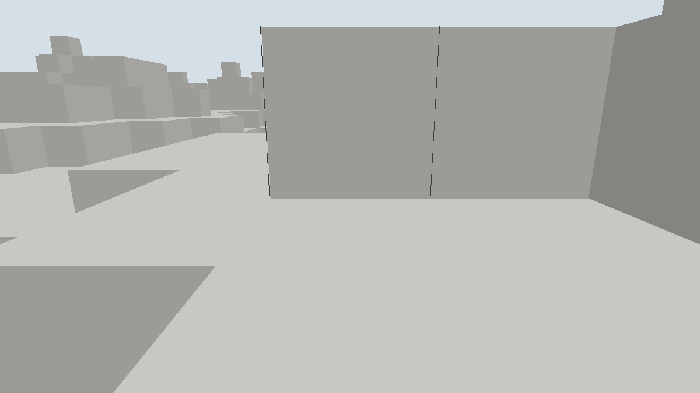

# 窗口行走场景记录

日期：[20261024]
类型：验收
状态：已验收
环境：Windows 11 x86_64，Rust 1.93.1，debug与release profile，Vulkan 后端（Intel RaptorLake 核显）
范围：未记录

## 目标

行走、重力与碰撞经A4移动事务在权威侧解析，画面为第一人称贴地视角。

## 方法

未记录

## 结果

### 输出

```text
# release，2400帧
frames=2401 streams=1 rebuilds=49 uploads=1 actions_ok=0 walk_ticks=33
walker=(8.5,8.9,3.3) sections=49 meshes=49 elapsed_ms=1712

# 对照：未启用自动跳跃前，行走到一格台阶前停下
walker=(8.5,7.9,4.3)
```

### 判读

- 移动经权威解析：每Tick把位移组装成A4移动事务提交，碰撞扫掠在准备阶段解析，发布给出最终位置；客户端只读回提交后的位置驱动相机。半尺寸0.3x0.9x0.3，20Tick每秒，步速4.3格每秒，重力28格每二次方秒，起跳8.4格每秒。
- 出生点换算经过校准：`Scene::eye`在地表方块顶上方1.4格，站立中心应在其上0.9格，出生按视线降0.5格取位。移动准备要求碰撞体不得已与地形重叠，出生嵌入会导致后续移动全部Conflict冻结，该边界已在代码注释与文档记录。
- 台阶阻挡符合A4原型语义：一格台阶挡住0.6宽碰撞体，无自动上台阶；自动演示在被挡的下一Tick起跳翻越，对照输出显示启用前停在z=4.3、启用后走到z=3.3并站上更高处。
- 行走模式下自动放置/破坏演示停用，避免堵住行走路径；点击编辑与材质切换在行走模式同样可用。
- 落地判定用提交位置与请求位置的差恢复：停在请求上方为落地并清零垂直速度，停在请求下方为顶头。

## 复现

### 运行命令

```sh
# 交互：F5在飞行与行走间切换，WASD行走，空格跳跃，鼠标拖动转向
cargo run -p torse-client -- --window --radius 4
# 自动取证：以行走模式启动并自动前进，遇到台阶自动跳跃
cargo run --release -p torse-client -- --window --walk --autoplay --frames 2400 --screenshot figures/M1-walk.png --radius 3
```

## 边界

### 未覆盖

- 实体本身不入画：玩家由相机表现，其他实体渲染待后续；行走实体不持久化，客户端世界无日志。
- 没有自动上台阶、斜坡滑落与水；出生嵌入地形时冻结，需切回飞行再切换。
- 移动事务无日志预留，客户端单机直接提交；网络模式下的移动走请求路径，待客户端联网装配。
- CI 不执行窗口运行；结果需本机复跑。

## 画面



相机在实体眼睛高度略带俯角，贴地第一人称视角，准星套在正前方方块上；近处方块大、远处透视缩小，与飞行俯瞰明显不同。
