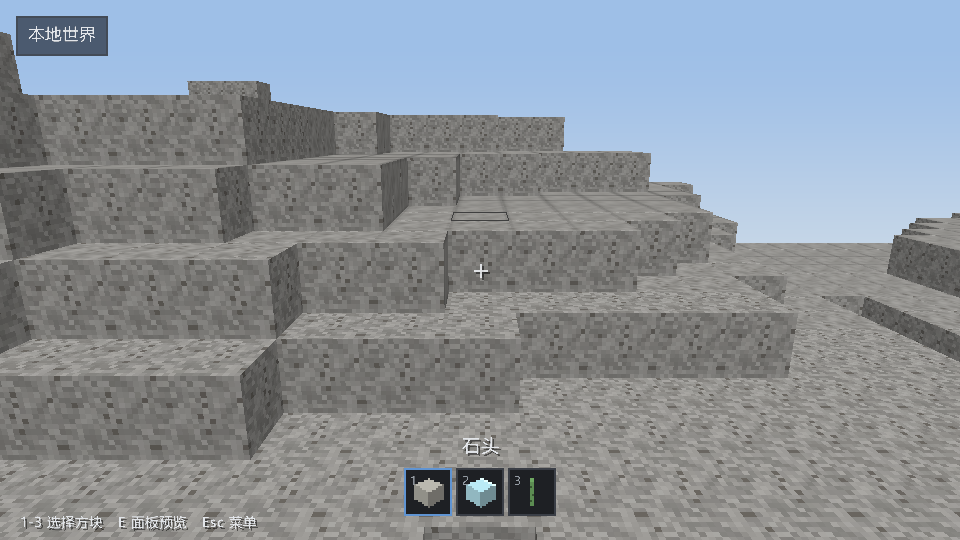
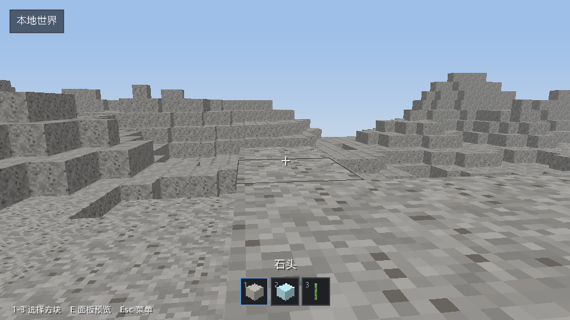

# 固定逻辑步与可变呈现帧验证

日期：[20261027]
类型：验收
状态：已验收
环境：Windows 11 x86_64，Rust 1.93.1，debug profile，NVIDIA GeForce RTX 4050 Laptop GPU，Vulkan，Bgra8UnormSrgb
范围：未记录

## 目标

代码：`feat/presentation-frame`，基于 `e89c589` 及本 PR 的计时、暂停和联网副本保护修复。内容为仓库内置基础游戏夹具，未加载外部内容包。

## 方法

### 2026-10-27：长帧边界审查回归

PR #18 审查发现，首轮修复只在未超出追赶上限的路径统一了浮点边界处理。50ms 步长遇到 2 秒长帧时，另一条取余路径得到 `presentation_alpha=0.9999999999999978`，随后仅经过 1ms 就额外执行一步；按步长计算的容差不足以消除这次长帧的舍入误差。原有 1 秒边界用例没有覆盖该情况。

修复统一按总逻辑步数处理浮点边界，再限制实际执行步数；非零余量携带其舍入容差，到完整步边界或重置时清除。这样既消除完整长帧留下的虚假余量，也避免真实半步余量在后续短帧到达边界时被错误延迟。极小步长导致商溢出的路径仍保留有限取余处理。

以下复现先在修复前失败，再在修复后通过：

```rust
let mut clock = torse_sim::PresentationClock::new(0.05, 8).unwrap();
assert_eq!(clock.pump_logic(2.0), 8);
assert_eq!(clock.presentation_alpha(), 0.0);
assert_eq!(clock.pump_logic(0.001), 0);
assert!((clock.presentation_alpha() - 0.02).abs() < 1e-12);
```

新增 3 项回归测试：2 秒长帧后按 1ms 小帧累计，到满 50ms 才执行下一步；4 种步长和 8 种长帧步数下的整数/半步余量；大间隔与商溢出路径。另覆盖距边界还差 1ns 的真实余量，确保不会被清零。

本次修复后，Windows 本机 `cargo fmt --all -- --check`、`cargo clippy --workspace --all-targets --locked -- -D warnings` 通过，`cargo test --workspace --all-targets --locked` 的 736 项测试通过。此前截图对应首轮图形验证，本次计时修复未重新进行图形后端或性能测量。

## 结果

### 契约与回归

对应 issue #7。`PresentationClock::pump_logic(dt)` 把真实墙钟间隔折算为固定逻辑步；窗口使用 50ms 步长，每帧最多追赶 8 步，超出的完整步丢弃，仅保留小数相位。它不推进权威 `TickClock`，不改变权威 Tick 的编号或提交规则。

相机位置在两个已完成逻辑位置之间按 `presentation_alpha()` 插值，鼠标转向每帧应用一次。`draw` 不推进移动或提交世界事务；分区流式、网格失效、后台结果接纳及 GPU 上传继续留在呈现帧，网格顶点不按 Tick 插值。

回归测试覆盖：

- 150ms 在 20Hz 下执行 3 步；30、60、144、1000fps 的一秒钟间隔均累计为 20 个逻辑步。
- 长帧追赶有上限，余量保留，下一帧不继承完整步积压；非有限间隔、重置和有限数相加溢出保持定义明确。
- 首帧和零间隔不凭空添加时间；10 微秒间隔不会被拉长，1 秒间隔由统一的 8 步上限处理。
- 飞行与行走都使用固定步长，改变呈现帧率不改变相同输入下的逻辑终点；追赶不重复应用转向。
- 暂停冻结呈现位置和相位；恢复不追赶暂停时间；位置校正同时替换两个端点并丢弃旧计时与阻挡状态。
- 联网场景在出生与行走结算入口拒绝本地行走，包括持有陈旧实体句柄的情况。拒绝前后的完整世界快照相同，编辑计数保持不变。

### 自动化检查

在仓库根目录执行：

```sh
cargo fmt --all -- --check
cargo clippy --workspace --all-targets --locked -- -D warnings
cargo test --workspace --all-targets --locked
cargo test -p torse-sim --lib presentation::tests --locked
cargo test -p torse-client window::tests --locked
cargo test -p torse-client scene::tests::network_scene_rejects_local_walking --locked
```

首轮修复后的工作区测试 733 项通过，后续长帧边界回归见文末。另在包含上游 `1b84910` 的临时合并副本中运行客户端与模拟层的全部目标测试，215 项通过；这与分支自身的全仓测试是两次不同范围的验证。后续上游 `888e197` 的文本合并检查无冲突，未宣称对该上游版本执行过完整工作区测试。

首次全仓测试中本机 TCP 监听因系统权限返回 10013；具备端口权限后重跑通过。没有为绕过该环境问题修改网络实现。

### 真实窗口验证

临时日志、世界与原始截图保存于 `.work/presentation-review/`。以下命令使用内置内容，截图命令会在指定呈现帧数之后再呈现一帧再退出。

```sh
cargo run -p torse-client --locked -- --window --autoplay --frames 120 --radius 1 --screenshot .work/presentation-review/fly.png
cargo run -p torse-client --locked -- --window --walk --autoplay --frames 180 --radius 2 --screenshot .work/presentation-review/walk.png
cargo run -p torse-client --locked -- --window --ui-preview pause --autoplay --frames 30 --radius 1
```

飞行运行呈现 121 帧，完成 6 次本地编辑，窗口重定心 2 次；行走运行呈现 181 帧，完成 59 个固定行走步；暂停运行呈现 30 帧，本地行走与编辑次数均为 0。这些运行长度由真实墙钟决定，不以呈现帧数推导逻辑步数。

联网验证在单独终端启动新的演示世界，再连接客户端：

```sh
cargo run -p torse-server --locked -- .work/presentation-review/network-world --listen 127.0.0.1:7777 --fill --ticks 200
cargo run -p torse-client --locked -- --window --connect 127.0.0.1:7777 --walk --frames 60 --screenshot .work/presentation-review/network.png
```

`--fill` 仅用于不存在的新世界。实际验证为回环地址上的临时端口，客户端收到 2 个分区的授权基线，呈现 61 帧，`walk_ticks=0`，未发送编辑请求。副本不能被本地出生或移动修改的断言由前述场景回归测试覆盖；这不代表权威服务端停止运行 Tick。

### 未覆盖范围

- 本次实际运行环境为 Windows/Vulkan，未在本地执行 Linux、macOS、DirectX 12 或 Metal 图形验证，跨平台结果仍以远端 CI 和相应设备复测为准。
- 服务端移动请求、权威移动结算与玩家位置校正协议未接入；本 PR 仅保留呈现位置重置入口，并禁止联网副本本地结算行走。
- issue #2 的新增流式与上传限额不在本次范围，保留既有呈现帧预算与“网格/派生缓存”类别，不新增动态呈现缓存。
- 未执行性能基准、长时间压力测试或新增 Mod 特性验证。

## 复现

未记录

## 边界

未记录

## 画面

### 画面与来源

以下两张 PNG 由本次验证运行的 `torse-client` 截取，使用仓库现有内置内容与材质；未引入第三方图片、字体文件或其他外部二进制素材。这里只把选定的最终画面保存为场景证据，原始运行产物仍留在 `.work/`。




