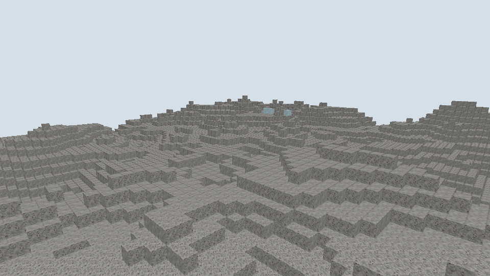

# 同材质接触面合并

日期：[20261025]
类型：验收
状态：已验收
环境：Windows，Rust 1.93.1，Vulkan，960x540，NVIDIA GeForce RTX 4080 SUPER
范围：未记录

## 目标

本轮实现接触面上同材质贴面的显式剔除，消除玻璃相邻时的重合闪面。

## 方法

### 行为

网格剔除新增同材质接触规则：接触面上两侧贴面材质相同、且本侧横截面被邻侧包含时，剔除本侧。横截面相等时两侧互为包含，双双剔除，玻璃墙内部不再有重合面；半砖贴同材质完整方块时剔除半砖那半面、保留完整面承载整个接触面，避免上半缺面。不同材质之间不受该规则影响，不透明方块的剔除仍由遮挡掩码负责，材质不透明前提与Mask/Blend零遮挡规则不变。

规则在网格层实现，按面材质与形状横截面判定，不新增内容字段；石头等不透明方块的同材质贴面同样受益（此前由掩码剔除，语义不变）。

## 结果

### 验证

网格测试更新一项、新增一项：无遮挡声明的同材质整块合并为10面，半砖贴同材质整块为11面（半砖侧面上并入大面）。全工作区553项测试通过，格式与Clippy零告警。离屏场景面数核对：相邻玻璃对10面、石头贴玻璃11面，合计21面，与捕获输出一致。复现命令：

```sh
cargo test -p torse-render --locked
cargo run -p torse-client -- --capture .work/pair.png --width 960 --height 540 \
  --place base:glass:6,12,0 --place base:glass:7,12,0 \
  --place base:stone:10,12,0 --place base:glass:11,12,0
```

## 复现

未记录

## 边界

未记录

## 画面



左侧两块相邻玻璃读作一个连续玻璃体，接触处无接缝与重合面；右侧透过玻璃可见石头贴面。

## 后续

横截面互不包含的部分重叠形状（当前基础内容不存在）仍可能残留重合面；透明面的绘制顺序仍按提交顺序，不做排序，玻璃幕墙大面积场景未做性能测量。
