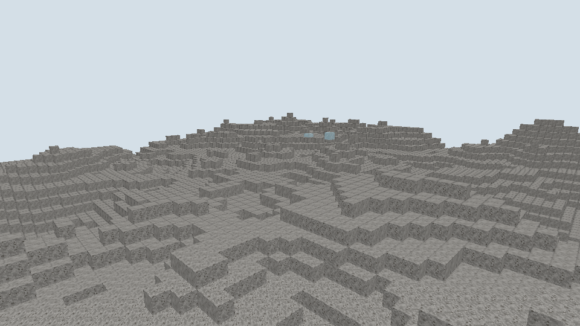

# 半砖遮挡修复与同格合并

日期：[20261025]
类型：验收
状态：已验收
环境：Windows，Rust 1.93.1，Vulkan，960x540，NVIDIA GeForce RTX 4080 SUPER
范围：未记录

## 目标

本轮修复半砖邻接面的透视剔除，并让同格两次放置半砖合并为完整方块。

## 方法

### 行为

半砖的遮挡掩码原为`0b110100`（底面与z向两侧），网格剔除是整面判定，z向邻接方块的共享面被整面删除，上半露出空洞形成透视；是否触发取决于观察方向。现改为只声明完整覆盖的底面`0b000100`。编译器新增校验：遮挡掩码不得声明渲染形状未完整覆盖的面，LowerSlab只允许底面，Box按触边与横跨范围判定，违规内容在编译期报错。

放置规则增加同格完成：InteractionProfile新增`completes_to`，半砖指向新增的完整玻璃方块`base:glass`（FullCube、Blend，与半砖共用玻璃材质）。目标格已有同种方块且其声明了完成目标时，放置改写为该目标方块，其余占用仍然拒绝。客户端瞄准可完成半砖的顶面时，放置目标指向该格自身而非上方一格，本地与联网路径都经动作服务走同一合并提交。完成目标进入权威摘要。

## 结果

### 验证

新增编译器测试两项（侧向遮挡声明被拒、完成目标必须是已注册方块）与场景测试一项（两次放置经动作服务合并为`base:glass`，第三次放置冲突）；注册表与内容测试随新方块更新。全工作区551项测试通过，格式与Clippy零告警。

遮挡场景按面数核对：每对石头加半砖恰产出11个面，半砖贴墙的-z面被石头剔除，石头的+z面在修复后保留；整体面数与放置数吻合。两次同格放置的离屏捕获提交序号连续（修复前第二次会以Conflict退出）。复现命令：

```sh
cargo test --workspace --all-targets --locked
cargo run -p torse-client -- --capture .work/merge.png --width 960 --height 540 \
  --place base:glass_slab:8,12,4 --place base:glass_slab:12,12,4 --place base:glass_slab:12,12,4 \
  --place base:stone:16,12,4
cargo run -p torse-client -- --capture .work/cull.png --width 960 --height 540 \
  --place base:stone:6,12,0 --place base:glass_slab:6,12,1
```

## 复现

未记录

## 边界

未记录

## 画面



左为单块半砖，中为两次放置合并出的完整玻璃，右为石头；两种玻璃共用同一材质。


石头墙前贴半砖：墙面完整，半砖以上没有透视空洞。

## 后续

合并只在同种方块之间生效；不同材质半砖同格、上半砖单独放置、破坏合并方块的返还仍是后续形状与库存任务。新增方块按内容键排序参与BlockStateId分配，早于半砖注册，此前的演示世界目录需要重建。
