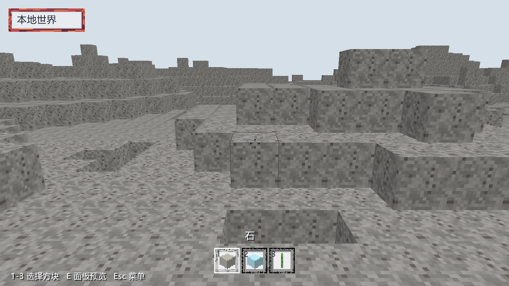
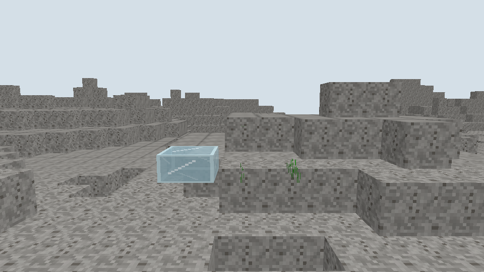

# 地形贴图与材质表场景记录

日期：[20261025]
类型：验收
状态：待复验
环境：Windows 11 x86_64，Rust 1.93.1，debug构建与release窗口各一次，Vulkan后端（NVIDIA GeForce RTX 4060 Laptop GPU）
范围：未记录

## 目标

离屏单帧、交互窗口、行走模式与联网镜像分别在真实GPU上运行；透明模式经放置方块后的离屏画面目检。

## 方法

### 实现范围

- 内容契约：`RenderProfile`新增逐面材质`face_materials`，缺失的面回落到方块材质；表达同一方块的顶面、侧面与底面使用不同材质。逐面材质进入表现摘要，不改变权威摘要。
- 网格：`RenderBlock`携带六个面的材质槽，`MeshData`为每个顶点输出面内局部坐标与逐面材质；面剔除与修订校验语义不变。
- 客户端：新增材质包与材质表。图集解码与材质包校验在`torse-assets`，材质键解析为图集矩形、色调与混合模式，顶点携带材质槽位，片元按槽位采样图集并乘色调与方向光。
- 混合模式：不透明、二值透明、半透明分别来自内容定义；二值透明按alpha阈值丢弃，半透明开启alpha混合。
- 图集留白与缺失图块：每张图块至少留一个像素空白；基础游戏新增品红棋盘格作为缺失图块，没有图集条目的材质显示它。
- mipmap：生成三级，先把图块内的透明像素填成最近实色像素，再向外扩张一个像素，最后逐级减半；放大用最近邻，缩小用线性过滤并按层级混合。
- 资源：基础游戏新增自绘图集`games/base/assets/textures/atlas.png`（120x24，五张图块）与生成脚本，客户端编译期嵌入。

## 结果

### 输出

```text
# 离屏全景
sections=25 meshes=25 entities=0 seq=0 vertices=76832 indices=115248 faces=19208 eye=(40.0,18.0,40.0) elapsed_ms=856

# 放置玻璃与植物
sections=25 meshes=25 entities=0 seq=3 vertices=76904 indices=115356 faces=19226 eye=(8.5,10.4,8.5) elapsed_ms=669

# 窗口，debug
adapter=NVIDIA GeForce RTX 4060 Laptop GPU backend=Vulkan format=Bgra8UnormSrgb frames=41
streams=1 rebuilds=85 uploads=85 screenshots=1 sections=81 meshes=81
vertices=234264 faces=58566 elapsed_ms=796
mean_frame_us=18219 max_frame_us=146290

# 联网镜像，debug
frames=61 session=1 batches=0 baseline_sections=2 sections=2 meshes=2
vertices=4528 faces=1144 elapsed_ms=1143
```

### 判读

- 贴图管线完整：图集采样、面内坐标、材质槽、色调与混合模式都在同一绘制通道中生效，画面中的石头表面按16x16贴图采样，近处与远处没有串色。
- 留白与mipmap有效：远处地形的噪点明显收敛，没有出现相邻图块串色或透明黑边；植物叶片在近处保持锐利，放大的玻璃高光没有发虚。
- 逐面材质可用：内容为石头、玻璃半砖与植物各声明一个材质；`face_materials`的六个槽位在网格层产生六个独立材质编号，网格测试钉住面顺序与回落规则。
- 透明分类可见：玻璃半砖以`blend`模式绘制并透出后方地形，植物以`mask`模式丢弃透明像素；石头的`opaque`模式不参与丢弃。
- 材质表有预算：材质表固定256项，超出时启动失败而不是绘制错误表面；同一材质被声明成两种混合模式时构造失败并给出材质键。
- 缺失图块可见：没有图集条目的材质显示品红棋盘格，便于在补图前发现漏配；白色图块只给实体色块这类调试表面提供可着色底图。
- 资源为自绘：图集由固定种子脚本生成，仓库不含第三方美术素材。

### 测试与检查

```sh
cargo fmt --all -- --check
cargo clippy --workspace --all-targets --locked -- -D warnings
cargo test --workspace --all-targets --locked
cargo doc --workspace --no-deps --locked
cargo test -p torse-mod-host --features package,authority --all-targets
cargo test -p torse-server --features mods --all-targets
```

全工作区534项测试通过，格式、Clippy（含Mod宿主与服务器mods特性）与Rustdoc零告警。Mod相关测试需要`rustup target add wasm32-unknown-unknown`，本轮为本机首次安装。新增测试覆盖逐面材质选择、局部贴图坐标、材质表字节布局、图集解码、矩形越界与留白冲突、重复材质、混合模式冲突、mipmap尺寸与实色填充、缺失图块与sRGB色调转换。

## 复现

### 运行命令

```sh
# 离屏全景
cargo run -p torse-client -- --capture out.png --width 960 --height 540 --radius 2
# 透明与形状检查：先放置一块玻璃半砖与两株植物
cargo run -p torse-client -- --capture alpha.png --width 960 --height 540 --radius 2 --view player \
    --place base:glass_slab:7,9,3 --place base:plant:8,9,3 --place base:plant:9,9,3
# 交互窗口，呈现40帧后保存最后一帧
cargo run -p torse-client -- --window --frames 40 --screenshot window.png
# 行走模式
cargo run -p torse-client -- --window --walk --frames 40 --screenshot walk.png
# 联网镜像：先在另一终端启动服务端
cargo run -p torse-server -- .work/tex-net --listen 127.0.0.1:7801 --fill --editors
cargo run -p torse-client -- --window --connect 127.0.0.1:7801 --frames 60 --screenshot net.png
```

## 边界

### 未覆盖

- 图集为最近邻放大、线性缩小与三级mipmap，没有各向异性过滤与纹理数组；mip层数固定在客户端常量里，图块很小的贴图包可能降到更低层后细节不足。
- 二值透明只做alpha阈值丢弃，没有alpha覆盖率或alpha-to-coverage；远处薄叶片会随mip变细，交叠的玻璃边缘也未验收。
- 半透明与不透明共用一次绘制并开启alpha混合，透明面之间没有排序；交叠顺序由绘制顺序决定，玻璃叠玻璃的观感未验收。
- 只验证了基础游戏的三个材质。材质包目前以代码常量声明，没有文件格式与热更新；留白要求由代码校验，外部工具生成的图集需要自行满足。
- 实体仍以色块绘制，实体贴图、动画帧、发光与纹理动画未接入。
- 场景内没有阴影与遮挡剔除优化；帧时数字仅代表本机debug构建，不构成性能承诺。
- CI不执行窗口与GPU画面，离屏渲染也需本地GPU；本记录的画面需按命令本机复跑。

## 画面





两张图均由客户端自身截图写入。第二张按上面的`--place`命令复现：左侧为玻璃半砖，可透出后方地形，表面保留高光条纹；右侧两株植物只保留叶片像素，背景透明。
