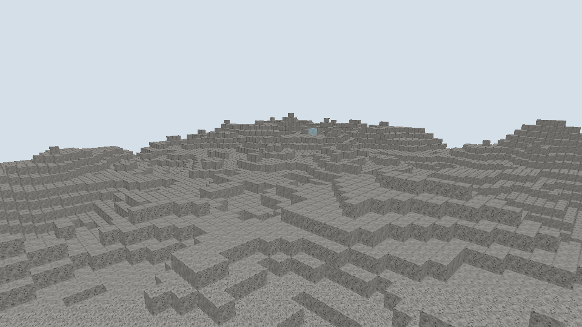

# 透明方块遮挡规则

日期：[20261025]
类型：验收
状态：已验收
环境：Windows，Rust 1.93.1，Vulkan，960x540，NVIDIA GeForce RTX 4080 SUPER
范围：未记录

## 目标

本轮让Mask与Blend材质的方块不得声明邻面遮挡，修复透过玻璃看到被剔除内面的问题。

## 方法

### 行为

上一轮的完整玻璃方块沿用了全遮挡掩码，透过玻璃会看到邻接方块被整面剔除的内面。现规定遮挡声明以材质不透明为前提：AlphaMode为Mask或Blend的方块遮挡掩码必须为零，邻接方块保留全部贴面；编译器在形状覆盖校验之外新增该诊断，违规内容编译期报错。玻璃半砖与完整玻璃的掩码随之归零，此前半砖声明的底面遮挡同样取消，地面隔着半砖也保持可见。

石头贴着玻璃时，石头的贴面保留、玻璃贴石头的一面仍被石头剔除；两个玻璃相邻时双方贴面都保留，透过可见接缝。玻璃之间消除接触面的显式表面剔除规则不在本轮引入，沿用契约中"玻璃之间是否消除接触面属于显式规则"的表述。

## 结果

### 验证

新增编译器测试一项：Blend材质声明任意遮挡被拒。全工作区552项测试通过，格式与Clippy零告警。离屏场景面数核对：石头6面、玻璃5面（贴石一面被剔除）、对照石头6面，共17面，与捕获输出一致。复现命令：

```sh
cargo test --workspace --all-targets --locked
cargo run -p torse-client -- --capture .work/glass.png --width 960 --height 540 \
  --place base:stone:6,12,0 --place base:glass:6,12,1 --place base:stone:10,12,0
```

## 复现

未记录

## 边界

未记录

## 画面



透过玻璃方块可见其后石头方块的贴面纹理，无缺面空洞；右侧为无遮挡对照。

## 后续

透明方块不遮挡带来更多可见面，大面积玻璃幕墙的面数与透明排序（当前交叠顺序按绘制顺序）未做测量；玻璃间接触面消除、按材质的显式剔除规则留给形状与渲染后续任务。
